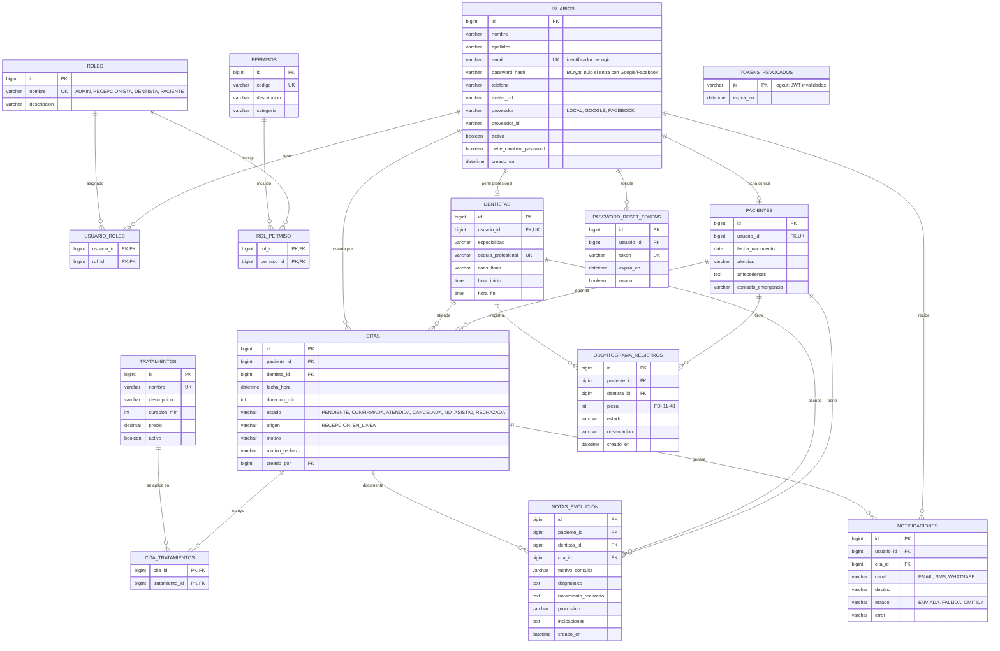
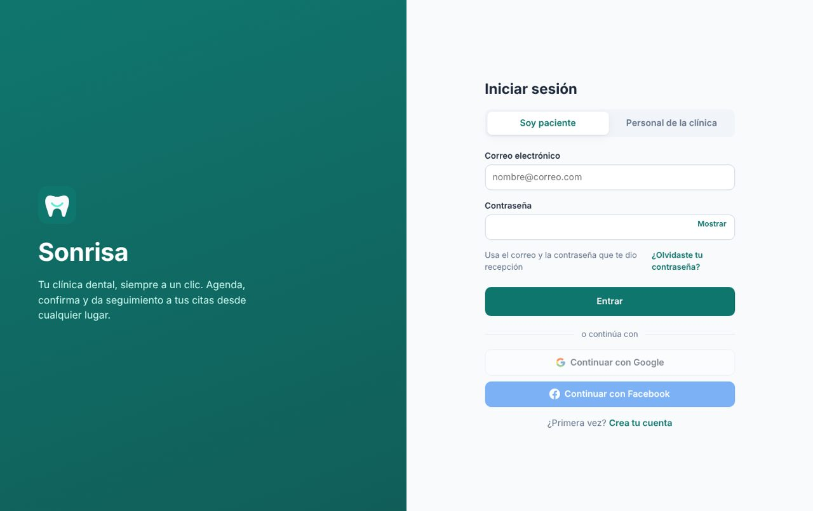
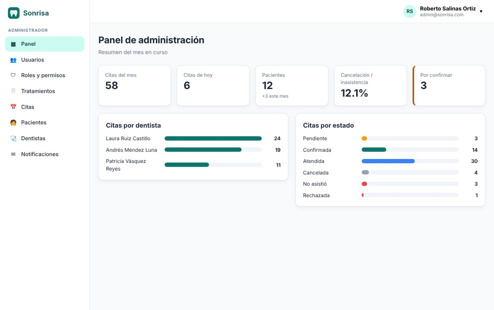
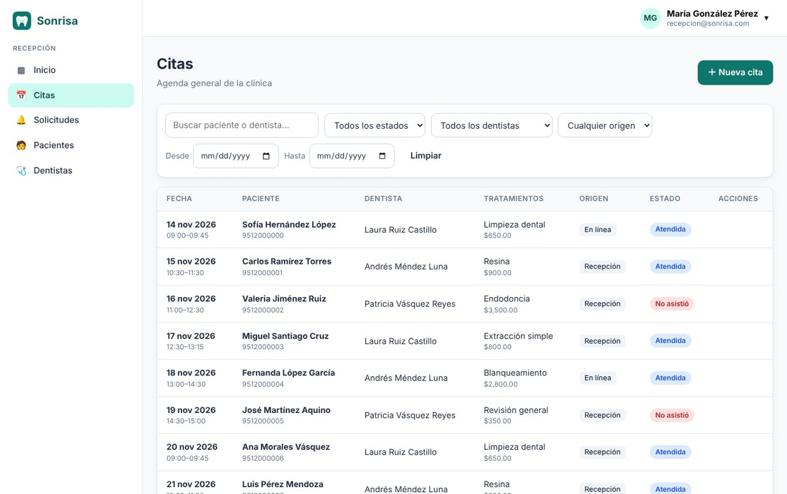
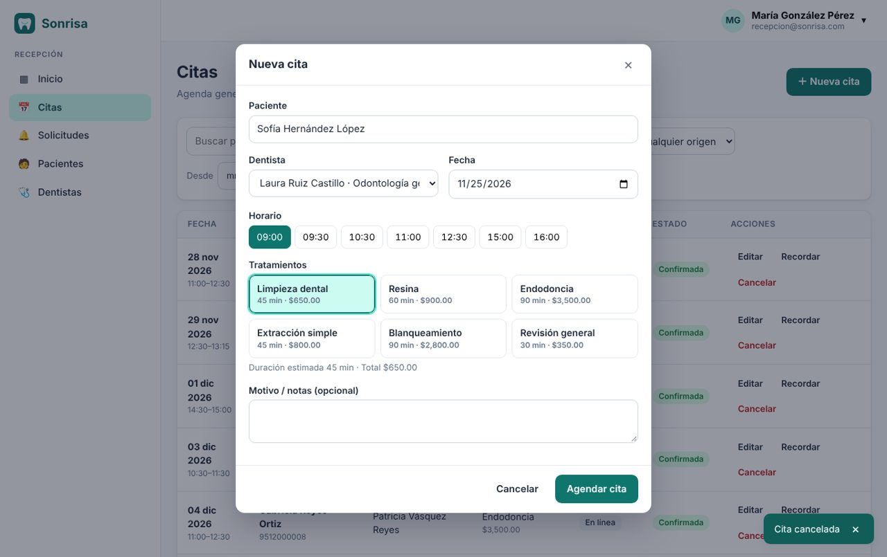
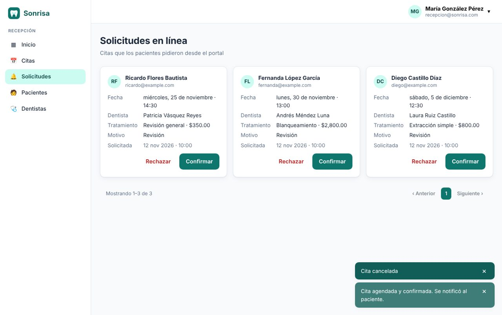
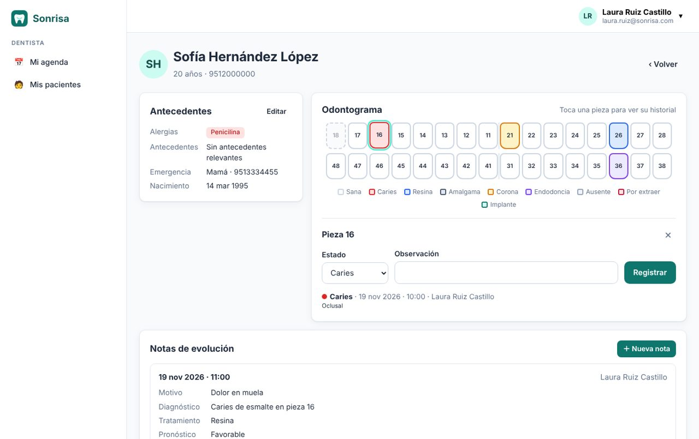
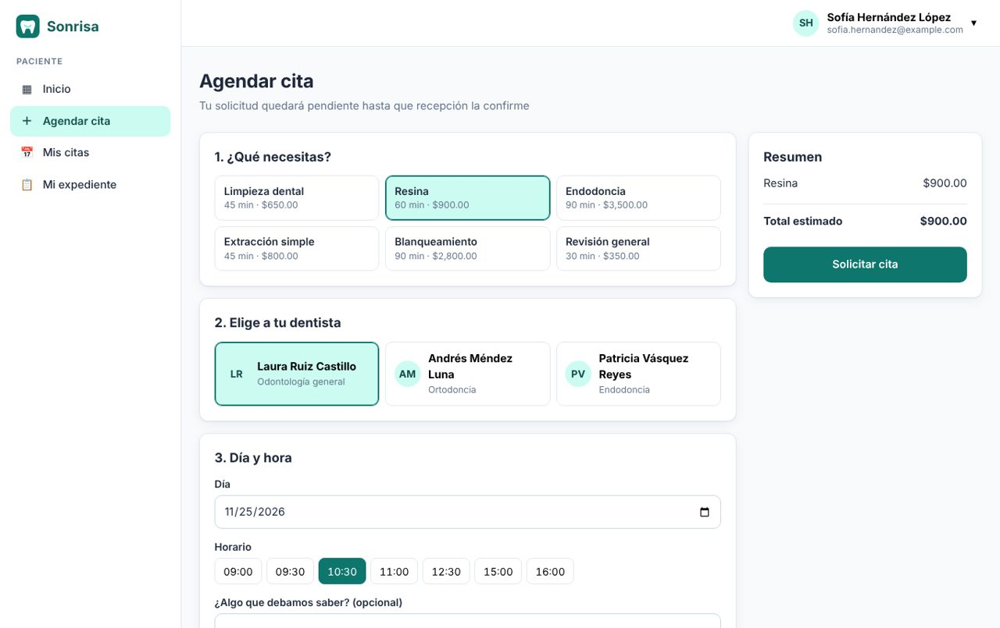
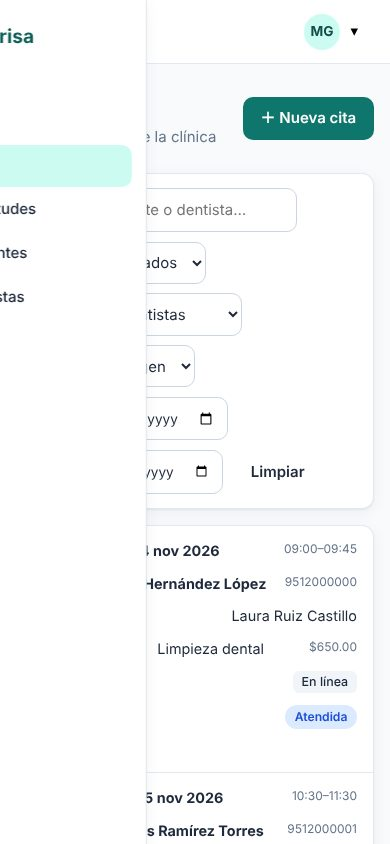

# 🦷 Sonrisa · Sistema de gestión para clínica dental

Sistema web full stack para una clínica dental. La **recepción** agenda citas y confirma las que los pacientes solicitan en línea. El **dentista** lleva su agenda y el expediente clínico (odontograma y notas de evolución). El **paciente** agenda y consulta sus citas desde un portal. El **administrador** gestiona usuarios, roles y catálogos.

Cada confirmación, cancelación o recordatorio se notifica al paciente por **correo** (Postfix propio + JavaMailSender), **SMS** (Twilio) y **WhatsApp** (WhatsApp Cloud API de Meta).

|                          |                                                                                       |
| ------------------------ | ------------------------------------------------------------------------------------- |
| 🌐 **Aplicación (HTTPS)** | [https://clinicasonrisas.online](https://clinicasonrisas.online)                      |
| 🔌 **URL base de la API** | `https://clinicasonrisas.online/api` (local: `http://localhost:8080/api`)             |
| 🎨 **Prototipo en Figma** | https://www.figma.com/design/l092qivLrA60IrFJkGJn79/Clinica-Sonrisas?node-id=0-1&t=bbGSUVH36mat4ACL-1 |
| 📋 **GitHub Projects**    | https://github.com/users/jpelon-jpg/projects/3 |
| 👥 **Equipo**             | Angel Sixto Morales · Jhonatan Ivan  Poblete Hernandez — Instituto Tecnológico de Oaxaca, 7SD, equipo 13 |

---

## Tecnologías

| Capa           | Tecnología                                                                                          |
| -------------- | --------------------------------------------------------------------------------------------------- |
| Backend        | Java 21, Spring Boot 3.5 (Web, Data JPA, Security, Validation, Mail), JWT (jjwt 0.12), Lombok       |
| Base de datos  | MySQL 8, migraciones con Flyway                                                                     |
| Frontend       | React 18, Vite 5, React Router 6, Fetch API                                                         |
| Notificaciones | Postfix + OpenDKIM (correo), Twilio (SMS), WhatsApp Cloud API de Meta (WhatsApp)                    |
| Acceso social  | Google Identity Services (implementado). El botón de Facebook está en la interfaz, pero no tiene credenciales configuradas. |
| Pruebas de API | Bruno (colección en `bruno/`)                                                                       |
| Despliegue     | VPS Ubuntu (Hetzner), systemd, Nginx, Let's Encrypt (Certbot)                                       |

## Roles y permisos

| Acción                                                    | Admin     | Recepción | Dentista               | Paciente  |
| --------------------------------------------------------- | --------- | --------- | ---------------------- | --------- |
| Usuarios, roles, tratamientos, bitácora de notificaciones | ✅         |           |                        |           |
| Registrar pacientes (con contraseña temporal por correo)  | ✅         | ✅         |                        |           |
| Agendar, editar, cancelar citas y enviar recordatorios    | ✅         | ✅         |                        |           |
| Confirmar o rechazar solicitudes en línea                 | ✅         | ✅         |                        |           |
| Marcar cita atendida / no asistió                         | ✅         | ✅         | ✅ (propias)            |           |
| Agenda propia y lista de sus pacientes                    |           |           | ✅                      |           |
| Expediente: antecedentes, notas de evolución, odontograma | 👁 lectura |           | ✅ (solo sus pacientes) | 👁 el suyo |
| Solicitar y cancelar citas en línea (24 h antes)          |           |           |                        | ✅         |
| Iniciar sesión con Google                                 |           |           |                        | ✅         |

**¿Por qué estas acciones para el dentista?** La NOM-004-SSA3-2012 (expediente clínico) pide que las notas de evolución registren diagnóstico, pronóstico e indicaciones. La NOM-013-SSA2-2015 (salud bucal) pide registrar el estado de cada pieza dental. Por eso el dentista solo **agrega** notas y registros al odontograma (numeración FDI 11–48) y nunca los edita ni los borra: el historial queda completo. Solo ve expedientes de pacientes que tienen o tuvieron cita con él.

## Credenciales de prueba

Las crea el `DataSeeder` la primera vez que arranca el backend (18 usuarios, 12 pacientes, 3 dentistas, 12 tratamientos, 30 citas, 12 notas de evolución y 15 registros de odontograma). Las contraseñas se guardan con **BCrypt**.

| Rol               | Correo                         | Contraseña      |
| ----------------- | ------------------------------ | --------------- |
| **Administrador** | `admin@sonrisa.com`            | `Admin#2026`    |
| Recepcionista     | `recepcion@sonrisa.com`        | `Recep#2026`    |
| Recepcionista     | `recepcion2@sonrisa.com`       | `Recep#2026`    |
| Dentista          | `laura.ruiz@sonrisa.com`       | `Dentista#2026` |
| Dentista          | `andres.mendez@sonrisa.com`    | `Dentista#2026` |
| Dentista          | `patricia.vasquez@sonrisa.com` | `Dentista#2026` |
| Paciente          | `sofia.hernandez@example.com`  | `Paciente#2026` |
| Paciente          | `carlos.ramirez@example.com`   | `Paciente#2026` |

El usuario **administrador de evaluación** es `admin@sonrisa.com`: tiene acceso total y credenciales fijas, para poder revisar el sistema sin afectar los datos de los demás.

Política de contraseñas (se valida en el frontend, bajo el input, y en el backend con Bean Validation): mínimo 8 caracteres, una mayúscula, un número y un carácter especial.

### Notas sobre SMS, WhatsApp y correo (cuentas de prueba)

Twilio y Meta se usan en modo de prueba, y por eso:

- **SMS (Twilio, cuenta trial):** solo se puede enviar a números verificados en la cuenta, y el mensaje usa una plantilla predefinida de Twilio (`sms_appointment_reminders`) en lugar del texto propio. Con una cuenta mejorada basta dejar vacía la propiedad `app.twilio.sms-template` para que se envíe el texto personalizado, sin cambiar código.
- **WhatsApp (Cloud API de Meta, número de prueba):** solo envía a los destinatarios registrados en la app de Meta (hasta 5) y usa la plantilla `hello_world`.
- **Correo (Postfix propio con SPF, DKIM y DMARC):** envía a cualquier dirección real. Sin servicios de terceros.

Para ver los tres canales en funcionamiento: iniciar sesión como administrador o recepcionista, abrir **Citas**, pulsar **Recordatorio** en una cita del paciente de prueba y revisar la pantalla **Notificaciones** (bitácora con el estado de cada envío: `ENVIADA`, `FALLIDA` u `OMITIDA`). La recuperación de contraseña se prueba desde el login con **¿Olvidaste tu contraseña?**.

### Evidencias de comunicación

| | |
| --- | --- |
|  Encabezados del correo en Gmail: SPF, DKIM y DMARC en `PASS` |  Correo de recuperación de contraseña recibido |
|  SMS y WhatsApp recibidos en el celular |  Bitácora de notificaciones del administrador |

## Diagrama entidad-relación



Relaciones N:M: **usuarios ↔ roles** (`usuario_roles`), **roles ↔ permisos** (`rol_permiso`) y **citas ↔ tratamientos** (`cita_tratamientos`).

Las tablas se crean y versionan con **Flyway** (`backend/src/main/resources/db/migration`): `V1` esquema, `V2` catálogos y `V3` permisos. Hibernate no genera ni modifica tablas (`spring.jpa.hibernate.ddl-auto=none`).

## Estructura del repositorio

```
ClinicaSonrisas/
├── backend/            API REST Spring Boot
│   └── src/main/java/com/sonrisa/api/
│       ├── config/         SecurityFilterChain, CORS, propiedades
│       ├── security/       JWT, filtro, UserDetailsService
│       ├── entity/         Entidades JPA
│       ├── repository/     Repositorios + Specifications (filtros en servidor)
│       ├── dto/            DTOs con Bean Validation (records)
│       ├── service/        Reglas de negocio
│       ├── controller/     @RestController
│       ├── notification/   Correo, SMS y WhatsApp asíncronos
│       ├── exception/      @RestControllerAdvice (400/401/403/404/422/500)
│       └── seed/           DataSeeder
├── frontend/           React + Vite
├── bruno/              Colección de pruebas de la API
├── database/           Script de creación y respaldo sonrisa_backup.sql
├── deploy/             Nginx, systemd, Postfix/OpenDKIM, guía de despliegue
├── docs/capturas/      Capturas de la aplicación
├── .github/workflows/  Integración continua (GitHub Actions)
└── docker-compose.yml  MySQL 8 para desarrollo local
```

## Instalación local

**Requisitos:** JDK 21, Maven 3.9+ (o el wrapper `mvnw`), MySQL 8 (no MariaDB), Node 20+.

```bash
git clone https://github.com/jpelon-jpg/ClinicaSonrisas.git
cd ClinicaSonrisas

# 1) Base de datos (elige una opción)
mysql -u root -p < database/crear_bd.sql      # a) MySQL instalado en tu equipo
# docker compose up -d                        # b) o MySQL 8 en Docker (usuario sonrisa_app / sonrisa_local)
# mysql -u root -p < database/sonrisa_backup.sql  # opcional: restaurar el respaldo con datos de prueba

# 2) Backend
cd backend
cp src/main/resources/application.properties.example src/main/resources/application.properties
#    edita: spring.datasource.password, app.jwt.secret (openssl rand -base64 48), Twilio, Meta, OAuth...
./mvnw spring-boot:run        # (Windows: mvnw.cmd) Flyway crea las tablas y el seeder carga los datos de prueba
# API en http://localhost:8080/api

# 3) Frontend (otra terminal)
cd frontend
cp .env.example .env.local   # VITE_GOOGLE_CLIENT_ID / VITE_FACEBOOK_APP_ID
npm install
npm run dev                  # http://localhost:5173 (Vite redirige /api al backend)
```

En local, los tres canales de notificación vienen **apagados** (`app.notificaciones.email.enabled`, `sms.enabled` y `whatsapp.enabled` en `false`) y la bitácora los registra como `OMITIDA`. Actívalos solo si tienes las credenciales correspondientes.

Pruebas unitarias: `cd backend && ./mvnw test`.

**Integración continua:** en cada `push`, GitHub Actions (`.github/workflows/ci.yml`) compila el backend, levanta MySQL 8, arranca la API con los datos de prueba y ejecuta toda la colección de Bruno. También compila el frontend.

### Respaldo de la base de datos

`database/sonrisa_backup.sql` contiene la estructura, el historial de Flyway y todos los datos de prueba, con las contraseñas en BCrypt. Las instrucciones están en [`database/README.md`](database/README.md).

## Seguridad y variables sensibles

- **Contraseñas con BCrypt.** Nunca se guardan en texto plano.
- **JWT** en el encabezado `Authorization: Bearer <token>`, con **logout que revoca el token** (tabla `tokens_revocados`).
- **Autorización por rol** en el backend (Spring Security) y **rutas protegidas por rol** en React.
- **Validaciones en frontend y backend:** Bean Validation en los DTOs, sin validaciones manuales en los controladores. Errores en JSON con el código correcto (400, 401, 403, 404, 422, 500) mediante `@RestControllerAdvice`.
- **Variables sensibles fuera del repositorio.** Clave JWT, credenciales de MySQL, correo, Twilio, Meta y Google viven en `application.properties` (en `.gitignore`) o, en el servidor, en un archivo `.env` con permisos `600` que carga systemd. El repositorio solo incluye `application.properties.example`, con los nombres de las variables y sin valores reales.
- **Historial:** el primer commit (`98b858d`) incluyó por error un `application.properties` de desarrollo local; se dejó de rastrear en `8ea1b93` y esas credenciales locales fueron cambiadas. Desde entonces ningún commit contiene credenciales.

## API (resumen)

Todas las rutas usan el prefijo `/api`. Las protegidas requieren `Authorization: Bearer <JWT>`. Los listados se paginan **en el servidor** (`page`, `size`, `sort`) y aceptan filtros como parámetros.

| Método              | Ruta                                                                      | Rol                      | Descripción                                                   |
| ------------------- | ------------------------------------------------------------------------- | ------------------------ | ------------------------------------------------------------- |
| POST                | `/auth/login` · `/auth/register`                                          | público                  | Inicio de sesión / registro de paciente                       |
| POST                | `/auth/google` · `/auth/facebook`                                         | público                  | Inicio de sesión social (pacientes). Facebook sin configurar. |
| POST                | `/auth/forgot-password` · `/auth/reset-password`                          | público                  | Recuperación de contraseña por correo                         |
| POST                | `/auth/logout`                                                            | autenticado              | Revoca el JWT actual (lista `tokens_revocados`)               |
| GET                 | `/auth/me` · PUT `/auth/change-password` · GET/PUT `/perfil`              | autenticado              | Sesión y perfil                                               |
| GET/POST/PUT/DELETE | `/usuarios` · PATCH `/usuarios/{id}/estado` · GET `/roles`                | ADMIN                    | Gestión de usuarios                                           |
| GET/POST/PUT/DELETE | `/tratamientos` (GET `/tratamientos/activos`)                             | ADMIN (lectura: todos)   | Catálogo                                                      |
| GET/POST/PUT/DELETE | `/pacientes` · POST `/pacientes/{id}/acceso`                              | ADMIN, RECEPCIONISTA     | Pacientes                                                     |
| GET                 | `/dentistas` · `/dentistas/{id}/disponibilidad?fecha=`                    | autenticado              | Dentistas y horarios libres                                   |
| GET/POST/PUT/DELETE | `/citas`                                                                  | ADMIN, RECEPCIONISTA     | Citas (filtros `q, estado, dentistaId, origen, desde, hasta`) |
| PATCH               | `/citas/{id}/confirmar` · `rechazar` · `cancelar`                         | ADMIN, RECEPCIONISTA     | Flujo de solicitudes                                          |
| PATCH               | `/citas/{id}/atender` · `no-asistio`                                      | + DENTISTA               | Cierre de la cita                                             |
| POST                | `/citas/{id}/recordatorio`                                                | ADMIN, RECEPCIONISTA     | Correo + SMS + WhatsApp                                       |
| GET                 | `/dentista/agenda` · `/dentista/citas` · `/dentista/pacientes`            | DENTISTA                 | Portal del dentista                                           |
| GET · PUT · POST    | `/expedientes/{pacienteId}` · `/antecedentes` · `/notas` · `/odontograma` | DENTISTA (ADMIN lectura) | Expediente clínico                                            |
| GET/POST/PATCH      | `/paciente/resumen` · `/paciente/citas` · `/paciente/expediente`          | PACIENTE                 | Portal del paciente                                           |
| GET                 | `/dashboard/{admin\|recepcion\|dentista\|paciente}`                       | según rol                | Indicadores                                                   |
| GET                 | `/notificaciones`                                                         | ADMIN                    | Bitácora de envíos                                            |

Formato de error (todas las respuestas 4xx/5xx):

```json
{ "timestamp": "2026-11-24T10:15:00", "status": 400, "error": "Bad Request",
  "message": "Revisa los datos enviados", "path": "/api/auth/register",
  "fieldErrors": { "email": "Escribe un correo válido" } }
```

## Pruebas con Bruno

Abre la carpeta `bruno/` en [Bruno](https://www.usebruno.com/), selecciona el entorno **Local** y ejecuta la colección completa (*Run collection*). Para probar contra producción, cambia la URL base del entorno a `https://clinicasonrisas.online/api`. Incluye: login de los 4 roles con guardado del JWT, peticiones autenticadas, paginación y filtros, flujo solicitud → confirmación, odontograma, casos de error **400, 401, 403, 404 y 422**, y logout que comprueba que el token revocado ya no funciona.

## Diseño y paleta de color

El prototipo navegable está en Figma (enlace arriba) y la implementación sigue sus pantallas: login con pestañas Paciente/Personal, panel de cada rol, overlays de "Nueva cita", "Registrar paciente" y "Cancelar cita". El logotipo (`frontend/public/logo.svg`) y la mascota (`frontend/public/mascota.png`) fueron diseñados por el equipo para este proyecto.

| Color          | Hex                   | Uso                                          |
| -------------- | --------------------- | -------------------------------------------- |
| Teal principal | `#0F766E`             | Marca, botones primarios, navegación activa  |
| Teal oscuro    | `#115E59`             | Hover, encabezados de marca                  |
| Teal suave     | `#CCFBF1`             | Fondos de selección y resaltados             |
| Aqua acento    | `#5EEAD4`             | Foco, detalles                               |
| Fondo          | `#F8FAFC`             | Fondo general                                |
| Texto          | `#1E293B` / `#64748B` | Texto principal / secundario                 |
| Ámbar / Rojo   | `#B45309` / `#B91C1C` | Pendientes / errores y acciones destructivas |

**Justificación (teoría del color):** el **verde azulado** es un color frío que se asocia con higiene, calma y salud. Baja la ansiedad típica de una visita al dentista y se aleja del blanco y azul "de hospital". La paleta es **análoga** (teal, aqua y verde menta), lo que da armonía y una sola identidad visual. Los **complementarios cálidos** (ámbar y rojo, opuestos al teal en el círculo cromático) se reservan solo para estados que requieren atención. Así un aviso o un botón de eliminar destacan por contraste sin competir con la marca. Los neutros pizarra dan legibilidad, y todos los textos cumplen contraste WCAG AA sobre su fondo.

## Capturas

| | |
| --- | --- |
| [](docs/capturas/01-login.jpg) Inicio de sesión (paciente: correo o Google) | [](docs/capturas/02-admin-panel.jpg) Panel del administrador |
| [](docs/capturas/03-recepcion-citas.jpg) Citas con filtros y paginación en servidor | [](docs/capturas/04-recepcion-nueva-cita.jpg) Nueva cita con horarios libres |
| [](docs/capturas/05-recepcion-solicitudes.jpg) Solicitudes en línea por confirmar | [](docs/capturas/06-dentista-expediente.jpg) Expediente con odontograma FDI |
| [](docs/capturas/07-paciente-agendar.jpg) El paciente agenda en línea | [](docs/capturas/08-movil-citas.jpg) Vista responsiva |

## Despliegue en el VPS

La aplicación corre en un VPS propio (Hetzner, Ubuntu) en [https://clinicasonrisas.online](https://clinicasonrisas.online). Sin plataformas externas ni servicios de pago de terceros:

| Pieza | Cómo está |
| --- | --- |
| **Backend** | JAR (`sonrisa-api.jar`) ejecutado como servicio **systemd** (`clinica.service`), escuchando solo en `127.0.0.1:8089` |
| **Frontend** | Build estático (`npm run build`) servido por **Nginx** desde `/var/www/clinicasonrisas` |
| **Proxy** | Nginx reenvía `/api/` al backend; el sitio y la API comparten el mismo dominio |
| **Base de datos** | MySQL 8 en el mismo servidor, usuario propio con permisos solo sobre la base `sonrisas` |
| **HTTPS** | Certificado gratuito de **Let's Encrypt** con **Certbot**, con renovación automática |
| **Correo** | **Postfix** + **OpenDKIM** en el VPS, con registros **SPF, DKIM y DMARC** en el DNS y DNS inverso configurado; la aplicación envía por `JavaMailSender` hacia el Postfix local |
| **SMS / WhatsApp** | Twilio (SMS) y WhatsApp Cloud API de Meta, llamados desde el backend |

Las variables sensibles se guardan en un archivo `.env` (permisos `600`) que systemd carga con `EnvironmentFile`, y nunca están en el repositorio. Nombres de las variables (sin valores):

```
SPRING_DATASOURCE_URL  SPRING_DATASOURCE_USERNAME  SPRING_DATASOURCE_PASSWORD
APP_JWT_SECRET  APP_JWT_EXPIRATIONMINUTES  APP_CORS_ALLOWEDORIGINS  APP_FRONTENDURL
SERVER_FORWARDHEADERSSTRATEGY  APP_SEED_ENABLED
SPRING_MAIL_HOST  SPRING_MAIL_PORT  APP_MAIL_FROM
APP_NOTIFICACIONES_EMAIL_ENABLED  APP_NOTIFICACIONES_SMS_ENABLED  APP_NOTIFICACIONES_WHATSAPP_ENABLED
APP_OAUTH_GOOGLE_CLIENTID  APP_OAUTH_FACEBOOK_APPID  APP_OAUTH_FACEBOOK_APPSECRET
APP_TWILIO_ACCOUNTSID  APP_TWILIO_AUTHTOKEN  APP_TWILIO_SMSFROM  APP_TWILIO_SMSTEMPLATE  APP_TWILIO_WHATSAPPFROM
APP_WHATSAPP_META_TOKEN  APP_WHATSAPP_META_PHONEID  APP_WHATSAPP_META_APIVERSION
APP_WHATSAPP_META_TEMPLATE  APP_WHATSAPP_META_LANGUAGE
```

Guía paso a paso en [`deploy/DESPLIEGUE.md`](deploy/DESPLIEGUE.md): servicio systemd, Nginx, Certbot, Postfix + OpenDKIM con SPF, DKIM y DMARC, y configuración de Twilio, Meta y Google.

## GitHub Projects

El avance del proyecto se lleva en un tablero público con las columnas **Backlog, To Do, In Progress, In Review y Done**: https://github.com/users/jpelon-jpg/projects/3.

## Distribución del trabajo

El historial de commits refleja el trabajo de ambos integrantes.

| Integrante | Áreas principales |
| --- | --- |
| **Angel Sixto Morales** | Diseño en Figma, frontend React, API REST, seguridad con JWT, entidades, módulos de negocio, seed y pruebas |
| **Jhonatan Ivan Poblete Hernandez** | Dominio y DNS, despliegue en el VPS (Nginx, systemd, HTTPS con Certbot, MySQL), Postfix + OpenDKIM con SPF/DKIM/DMARC, integración de SMS (Twilio) y WhatsApp (Cloud API de Meta), pruebas de integración, documentación |
